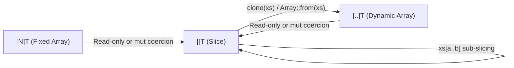

# Ril Sequence Types Design: Fixed Arrays, Slices, and Dynamic Arrays

## 1. Overview & Taxonomy

Ril partitions contiguous linear sequences into three orthogonal types based on **length mutability** and **ownership**:

| Type | Name | Length Semantics | `mut` Capability | Memory Representation |
| :--- | :--- | :--- | :--- | :--- |
| **`[N]T`** | **Fixed Array** | Compile-time constant `N` ($N \ge 0$) | **In-place element mutation only** | Inline contiguous elements ($N \times \text{sizeof}(T)$) |
| **`[]T`** | **Slice** | Runtime-fixed length; **cannot resize** | **In-place element mutation only** | Fat pointer `(data_ptr, len)` (2 words, zero heap allocation) |
| **`[..]T`** | **Dynamic Array** | Runtime-variable length; **growable** | **Structural resize (`push`/`pop`) + in-place element mutation** | Managed buffer `(data_ptr, len, cap)` |

### Core Design Principles
1. **Separation of Element Mutation and Structural Resizing**: `mut []T` and `mut [N]T` permit mutating existing element slots in place (`xs[i] = v`) but statically forbid changing length. Only `mut [..]T` permits structural changes (`push`, `pop`, `insert`, `remove`, `truncate`).
2. **Ergonomic Default for Signatures (`[]T`)**: Functions that read or mutate elements in place without resizing accept `[]T` or `mut []T`. Both `[N]T` and `[..]T` coerce implicitly to `[]T` with zero copying.
3. **Strict Distinction Between Immutable (`let`) and Read-Only (`let view`)**: `let` guarantees deep immutability (no surviving writers exist). A read-only slice over a mutable source (`let mut`) is **read-only, not immutable**, and MUST be bound with `let view`.

---

## 2. Syntax & Type Inference

### 2.1 Grammar

```ebnf
ArrayType ::= "[" [ ".." | Expression ] "]" TypeExpression
```

* `[N]T`: Fixed array of compile-time `int` length `N` (`N < 0` triggers `E0815`; non-`int` triggers `E0323`; non-const triggers `E0814`).
* `[]T`: Fixed-length slice over contiguous elements of type `T`.
* `[..]T`: Growable dynamic array of elements of type `T`.

### 2.2 Array Literal Inference (`[e1, e2, ...]`)

| Context | Inferred Type | Example |
| :--- | :--- | :--- |
| Expected type is `[N]T` | `[N]T` (arity checked at compile time) | `let buf: [4]u8 = [0, 0, 0, 0]` |
| Expected type is `[]T` | `[]T` | `fn sum(xs: []int)` called as `sum([1, 2, 3])` |
| Expected type is `[..]T` or **unconstrained** | **`[..]T`** | `let mut xs = [1, 2, 3]` (inferred as `[..]int`) |

> **Rationale**: Defaulting unconstrained array literals to `[..]T` allows `let mut xs = [1, 2, 3]; xs !> Array::push(4)` without type annotations, while still passing seamlessly to any `[]T` parameter via implicit coercion.

---

## 3. Coercion & Subtyping Rules

Element type `T` is invariant across all three sequence types. Zero-copy view coercion follows a strict one-way funnel into `[]T`:



| Source $\to$ Target | Read-Only (`T`) | Mutable (`mut T`) | Semantics |
| :--- | :---: | :---: | :--- |
| `[N]T` $\to$ `[]T` | Allowed | Allowed (`mut [N]T` $\to$ `mut []T`) | Zero-copy whole-sequence window `arr[0..N]` |
| `[..]T` $\to$ `[]T` | Allowed | Allowed (`mut [..]T` $\to$ `mut []T`) | Zero-copy whole-sequence window `arr[0..len(arr)]` |
| `[]T` $\to$ `[..]T` | **Rejected (`E0301`)** | **Rejected (`E0301`)** | Slices lack capacity/ownership; use `clone` or `Array::from` |
| `[]T` $\to$ `[N]T` | **Rejected (`E0301`)** | **Rejected (`E0301`)** | Runtime length cannot satisfy compile-time fixed length |
| `[N]T` $\to$ `[..]T` | **Rejected (`E0301`)** | **Rejected (`E0301`)** | Fixed arrays cannot resize; convert explicitly |

---

## 4. Slicing & Binding Permissions Matrix

Slicing any sequence (`[N]T`, `[..]T`, or `[]T`) with a range expression `arr[a..b]` or `arr[a..=b]` always yields static type **`[]T`**. It evaluates `arr` and the bounds once and creates a zero-copy window over the selected elements.

The permitted binding mode depends strictly on the provenance of the source array:

| Source Provenance | Desired Access | Required Form | Rules & Guarantees |
| :--- | :--- | :--- | :--- |
| **Immutable (`let`)** | Immutable | `let s = arr[a..b]` | **Deeply immutable (`Immut`)**. No writers exist; `s` can be shared freely across tasks (`s.fork`) and stored in immutable aggregates. `let view` is rejected (`E0531`). |
| **Mutable (`let mut`)** | Read-only live observation | `let view s = arr[a..b]` | **Read-only live view**. `let` is rejected (`E0535`: surviving writer). `var` is rejected (`E0531`: live views must be pinned). In-place element writes on `arr` remain visible through `s`. |
| **Mutable (`let mut`)** | Temporary mutable argument | `f(mut arr[a..b])` | **Scoped mutable slice loan**. `f` receives `mut []T`: it may mutate elements in `a..b` in place, cannot resize, and holds exclusive access to `arr` for the duration of the call. |
| **Mutable (`let mut`)** | Local mutable slice handle | `let mut s = ^mut arr[a..b]`<br/>or `Array::split_at(mut arr, mid)` | **Pinned mutable slice**. Permits `s[i] = v` in-place writes. Rebinding `s` is rejected (`E0502`). Resizing `s` is rejected by type (`[]T`). |

### Why `var` is Prohibited on Live Slice Views
* A slice derived from a `let mut` source is a **live view**, not an independent value.
* Allowing `var s = mut_arr[a..b]` would conceal its live-view nature (losing the explicit `view` marker) and force static provenance analysis to conservatively lock the structural stability (`E0537`) of every array ever assigned to `s` across loops and branches.
* Cursor iteration over live mutable arrays should use an `int` index (`var i = 0`) or a read-only parameter boundary. (`var` remains valid over deeply immutable `let` slices, as no live writer exists.)

---

## 5. Exclusivity & Structural Stability Invariants

### 5.1 Structural Stability (`E0537`)
While any live slice (`let view` or `let mut` slice) derived from a dynamic array `mut_vec: [..]T` remains active (has a statically possible subsequent use), **all structural mutations on `mut_vec` (`push`, `pop`, `insert`, `remove`, `truncate`) are statically rejected (`E0537`)**.
* Once the last use of the slice and its aliases completes, `mut_vec` immediately regains structural mutation authority.
* Fixed arrays `[N]T` and slices `[]T` cannot change length by definition, so `E0537` only applies to `[..]T` origins.

### 5.2 Law of Exclusivity (`E0523` / `E0524`) & Disjoint Splitting
* **Live Read-Only View (`let view s = arr[a..b]`)**: The owner `arr` may still perform in-place element replacements (`arr[i] = v`), which `s` observes live, provided no overlapping mutable loan is active simultaneously.
* **Mutable Slice (`mut arr[a..b]`)**: Obeys strict read/write and write/write exclusivity (`E0523` / `E0524`). Because arbitrary runtime ranges `arr[a..b]` and `arr[c..d]` cannot be statically proven disjoint, borrowing two mutable slices directly from the same `arr` at the same time triggers `E0523`.
* **Disjoint Mutable Splitting (`Array::split_at`)**: To obtain multiple simultaneous mutable sub-slices for divide-and-conquer or `Parallel::join`, use `Array::split_at(mut xs, mid) -> ([]T, []T) &mut`, which establishes statically disjoint writable origins for the left `[0..mid]` and right `[mid..len]` slices.

```ril
fn par_quicksort(mut xs: []int) &mut {
    if len(xs) <= 1 { return }
    let pivot = partition(mut xs)
    let (mut left, mut right) = Array::split_at(mut xs, pivot)
    Parallel::join(
        \-> par_quicksort(mut left),
        \-> par_quicksort(mut right),
    )
}
```

### 5.3 Concurrency & Escape Confinement (`E0601`)
* Live slice views (`let view`) and mutable slices (`let mut s: []T`) cannot cross concurrent task boundaries (`s.fork`) or be stored into escaping heap structures (`E0601` / `E0535`).
* To detach a slice into an independent heap buffer, explicitly materialize it via `clone(s)` or `Array::from(s) -> [..]T`.

---

## 6. Standard Library (`ril/array` & `ril/parallel`) Conventions

Standard library signatures follow the **Liberal Input (`[]T`), Rich Output (`[..]T`), Explicit Resize (`mut [..]T`)** convention:

```ril
-- 1. Read-Only Queries & Folding (accept []T; compatible with [N]T, [..]T, and slices)
pub fn first<T>(items: []T) -> ?T
pub fn get<T>(items: []T, index: int) -> ?T
pub fn contains<T>(items: []T, value: T) -> bool
pub fn fold<T, A>(items: []T, initial: A, step: fn(A, T) -> A) -> A
pub fn find<T>(items: []T, predicate: fn(T) -> bool) -> ?T
pub fn any<T>(items: []T, predicate: fn(T) -> bool) -> bool
pub fn all<T>(items: []T, predicate: fn(T) -> bool) -> bool
pub fn for_each<T>(items: []T, action: fn(T) -> ())

-- 2. In-Place Element Mutations (accept mut []T; compatible with mut [N]T, mut [..]T, and mut slices)
pub fn swap<T>(mut items: []T, i: int, j: int) &mut
pub fn fill<T>(mut items: []T, value: T) &mut
pub fn reverse_in_place<T>(mut items: []T) &mut
pub fn sort<T>(mut items: []T) &mut
pub fn split_at<T>(mut items: []T, mid: int) -> ([]T, []T) &mut

-- 3. Allocating Transformations (accept []T, return fresh owned [..]U / [..]T)
pub fn from<T>(items: []T) -> [..]T
pub fn reverse<T>(items: []T) -> [..]T
pub fn concat<T>(left: []T, right: []T) -> [..]T
pub fn map<T, U>(items: []T, transform: fn(T) -> U) -> [..]U
pub fn filter<T>(items: []T, predicate: fn(T) -> bool) -> [..]T

-- 4. Structural Resizing Operations (strictly require mut [..]T)
pub fn push<T>(mut items: [..]T, value: T) &mut
pub fn pop<T>(mut items: [..]T) -> ?T &mut
pub fn insert<T>(mut items: [..]T, index: int, value: T) &mut
pub fn remove<T>(mut items: [..]T, index: int) -> T &mut
pub fn truncate<T>(mut items: [..]T, length: int) &mut

-- 5. Deterministic Data Parallelism (ril/parallel)
pub fn map<T, U>(items: []T, transform: fn(T) -> U) -> [..]U
pub fn for_each<T>(mut items: []T, action: fn(mut T) -> ()) &mut
```

---

## 7. Compiler Representation & Optimizations

| Construct | Lowered Representation | Key Compiler Optimizations |
| :--- | :--- | :--- |
| **`[N]T`** | Contiguous inline block of $N \times \text{sizeof}(T)$ bytes; no runtime header | **Stack Allocation**: Allocated on the stack frame when non-escaping (including when coerced to `[]T` for downward calls).<br/>**Inline Flattening**: Nested arrays (`[4][4]f32`) and record fields flatten into a single allocation.<br/>**Static BCE & SIMD**: Compile-time bounds check elimination and loop auto-vectorization. |
| **`[]T`** | 2-word fat pointer `(data_ptr, len)` (with GC base-object tracking for interior pointers) | **Zero Heap Allocation**: `arr[a..b]` compiles to bounds check + pointer offset (`ptr + a * stride`) + length subtraction (`b - a`).<br/>**Register ABI (SROA)**: Passed and returned directly in two CPU registers.<br/>**Polymorphism-Free**: Uniform layout regardless of whether the backing store is stack `[N]T` or heap `[..]T`. |
| **`[..]T`** | Managed header `(data_ptr, len, cap)` pointing to a geometrically growable heap buffer | **Pointer & Length Hoisting (LICM)**: Because `E0537` and `mut []T` statically forbid reallocation during active borrows/loops, `data_ptr` and `len` are cached in registers without reloading from memory after calls.<br/>**Exact Literal Pre-allocation**: `[e1, ..., ek]` allocates exact initial capacity $k$ in one step. |