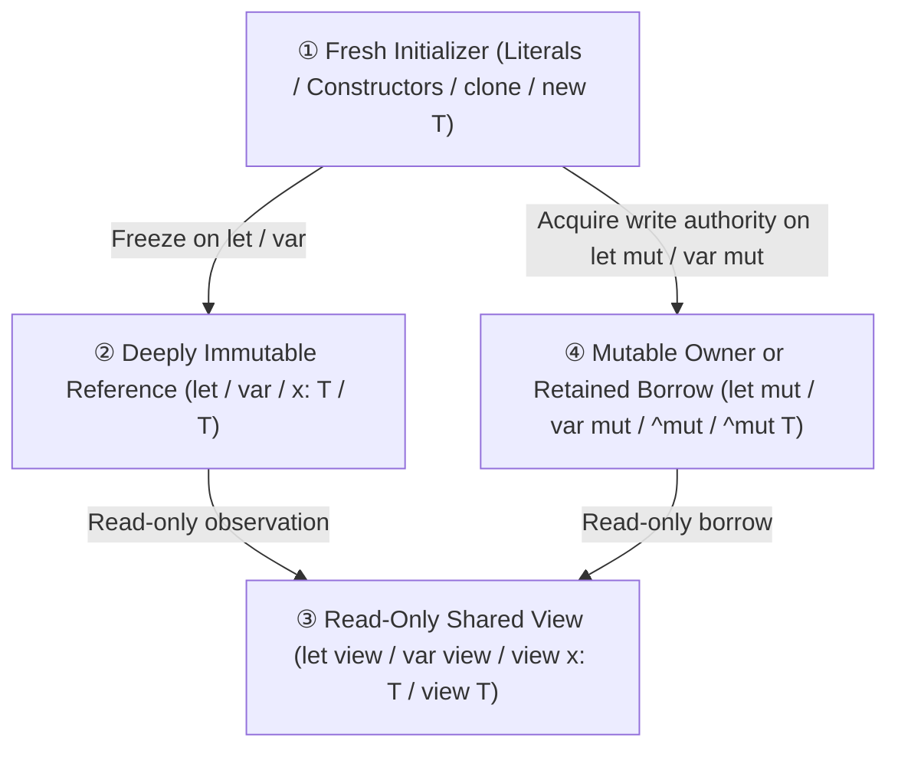

# Ril Sequence Types & Built-In Collection Specifications

## 1. Collections Overview & Taxonomy

Ril cleanly partitions contiguous linear sequences and associative containers into built-in types based on **memory allocation** and **length mutability**:

| Type | Name | Mutability & Allocation | Length Semantics | Memory Representation |
| :--- | :--- | :--- | :--- | :--- |
| **`[N]T`** | **Fixed Array** | Value Type | Compile-time constant $N$ ($N \ge 0$) | Inline contiguous elements ($N \times \text{sizeof}(T)$ bytes) |
| **`[]T`** | **Dynamic Array** | Reference Type (GC-managed) | Runtime-variable length; growable | Managed GC heap buffer `(data_ptr, len, cap)` |
| **`[K: V]`** | **Map** | Reference Type (GC-managed) | Dynamic key-value pairs | Managed GC hash table |
| **`str`** | **String** | Immutable Value Type | UTF-8 text sequence | Managed pointer + byte length |
| **`bytes`** | **Bytes** | Immutable Value Type | Raw byte sequence | Managed pointer + byte length |

### Core Design Principles
1. **Two Concrete Array Types, Zero Slice Types**: Ril has no third "slice" type. All non-owning inspection and borrowing over arrays and collections are unified under the orthogonal **`view`** capability qualifier (`view []T` or `view [N]T`), eliminating complex lifetime annotations and redundant container wrappers.
2. **Separation of Element Mutation and Structural Resizing**: `mut [N]T` permits mutating existing element slots in place (`xs[i] = v`) but statically forbids changing length. Only `mut []T` permits structural modifications (`push`, `pop`, `insert`, `remove`, `truncate`).
3. **Immutable by Default, Explicit `view`, `mut`, and `new`**: Unmodified bindings and types (`let x: T`, `fn f(x: T)`, `[]T`) are **deeply immutable by default**. Read-only shared views use **`view`**, write access uses **`mut`** / **`^mut`**, and unaliased fresh values use **`new`**.

---

## 2. Capability & Reference Model

### 2.1 The 2 × 3 Orthogonal Binding Matrix

Local variable declarations separate **slot reassignability** (`let` vs. `var`) from **data permission & sharing** (default immutable vs. `view` vs. `mut`):

| Data Permission \ Slot Kind | `let` (Pinned slot: cannot `x = ...`) | `var` (Reassignable slot: can `x = ...`) | Semantics & Guarantees |
| :--- | :--- | :--- | :--- |
| **Default (Deeply Immutable)** | **`let x: T`** | **`var x: T`** | **True deep immutability**. Entire reachable graph has no surviving writer; freely shareable across tasks and storable in immutable aggregates. |
| **`view` (Read-Only Shared View)** | **`let view x: T`** | **`var view x: T`** | **Read-only view**. Grants non-owning read access over heap reference types. Forbids interior writes through `x` and cannot freeze into `let`/`var` without `clone`. |
| **`mut` (Mutable Authority)** | **`let mut x: T`** | **`var mut x: T`** | **Interior/element write permission** for reference types. Subject to exclusivity (`E0523`/`E0524`). |

* Primitive value types (`int`, `bool`, `f64`, `str`, `bytes`, `[N]T`) copy by value: declaring a scalar as `let mut` or taking `view` over a scalar is statically rejected under `E0402`.

### 2.2 `view` as a Read-Only Capability on Reference Types

In Ril, **`view` is an orthogonal read-only capability applied to GC-managed reference types** (`[]T`, `[K: V]`, records, and sum types):

1. **Object-Level Referencing & GC Lifetime Guarantee**:
   `let view v = target` holds a read-only reference to the underlying heap object. Because Ril is backed by a tracing garbage collector, the referenced object remains live as long as `v` is alive.
2. **Safe Slot Replacement (No Dangling, No Enum Confusion)**:
   If a container's slot or variable is reassigned from the root:
   ```ril
   type TaskStatus { Pending(str), Finished(int) }
   let mut tasks: []TaskStatus = [TaskStatus::Pending("waiting")]
   let view v = tasks[0]          -- 'v' holds a read-only view of the 'Pending("waiting")' heap object

   tasks[0] = TaskStatus::Finished(42)  -- Slot 0 is updated to a new heap object
   ```
   * **Result**: `v` continues safely holding the original `Pending("waiting")` object (which is preserved by GC root tracking).
   * **Zero Dangling Pointers**: No physical memory is deallocated prematurely.
   * **Zero Enum Type Confusion**: The old `Pending` payload is not overwritten in place; `v` reads its string safely without invalidation.
3. **Dynamic Array Observation**:
   A `view []T` references the array's managed header. If the owner resizes the array (`push`/`pop`), the view observes the updated elements.
4. **Iteration Safety (`E0526`)**:
   Modifying an array structurally (`push`/`pop`/`clear`) while a loop is actively iterating over it is statically rejected under `E0526: CollectionMutationDuringIterationError`.

### 2.3 The 4-State Reference & Permission Lattice



* **① Fresh Initializer (`new T`)**: Newly allocated literals (`[1, 2, 3]`), constructors (`Cell.{ count: 0 }`), `clone(view x) -> new T`, and functions returning `-> new T`.
  * Can freeze into **② Deeply Immutable (`let` / `var`)** or acquire write authority as **④ Mutable (`let mut` / `var mut`)**.
  * Cannot bind directly to `let view` / `var view` (`E0531: FreshTargetViewError`). Passing `new T` to a `view` parameter implicitly materializes an anonymous temporary on the caller's frame.
* **② Deeply Immutable Reference (`T`)**: Bound `let` / `var` variables and functions returning `-> T`. Freely shared across concurrent tasks without locks or copies. Cannot bind to `let mut` (`E0528`).
* **③ Read-Only Shared View (`view T`)**: Bound `let view` / `var view` variables and `view` parameters. Cannot flow into `let` (`E0535`) without explicit `clone`. Cannot cross concurrent tasks (`E0601`).
* **④ Mutable Owner / Retained Borrow (`mut T` / `^mut T`)**: Write authority subject to exclusivity (`E0523`/`E0524`).

### 2.4 Strict `derive` Input Invariant

Built-in functional update `derive<T>(base: T, recipe: fn(mut draft: T) -> ()) -> new T`:
* **Accepts only Deeply Immutable values (State ② `T`) or Fresh values (State ① `new T`)**.
* **Strictly rejects `view` (`E0536: NonImmutableDeriveInputError`)**: `view` may observe dynamically mutating data. `derive` operates strictly on frozen, deterministic snapshots. To derive from an observed view, callers explicitly clone first: `clone(observed) |> derive \mut d -> ...`.

### 2.5 Function Parameter Modes & Return Provenance

| Parameter Form | Caller Argument | Callee Semantics |
| :--- | :--- | :--- |
| **`x: T`** | Deeply immutable (`let`, `var`, or `new`) | **Deeply immutable (`let` semantics)**. Freely storable in immutable structures or shareable across tasks. |
| **`view x: T`** | Immutable, view, or mutable reference | **Read-only view (`let view` semantics)**. Inspects elements without copying. Caller passes ordinary expression. |
| **`mut x: T`** | `mut target` (or `target !> f()`) | **Temporary mutable borrow**. In-place element/slot writes; cannot be retained after return. |
| **`^mut x: T`** | `^mut target` | **Retained mutable borrow**. Write access with permission to retain/return a writable alias under `&^mut`. |

#### Return Signatures

| Return Signature | Value Provenance | Caller Binding |
| :--- | :--- | :--- |
| **`-> new T`** | Newly constructed inside callee; no surviving external aliases. Mandatory in `.d.ril` external constructors and `fn() -> new T` callables. | `let`, `var` (freeze)<br/>`let mut`, `var mut` (keep writable) |
| **`-> T`** | Borrowed or projected from an immutable origin. | `let`, `var`<br/>`let view`, `var view` |
| **`-> view T`** / **`-> view(p) T`** | Read-only view borrowed from parameter `p`. | `let view`, `var view`<br/>*(plus `let`/`var` via Provenance Passthrough when origin arguments are deeply immutable)* |
| **`-> ^mut T`** / **`-> ^mut(p) T`** | Writable reference borrowed from `^mut` parameter `p` under `&^mut`. | `let mut`, `var mut`<br/>`let view`, `var view` |

---

## 3. Sequence Syntax & Type Inference

### 3.1 EBNF Grammar

```ebnf
(* ========================================== *)
(* Sequence and Map Type Grammar              *)
(* ========================================== *)

ArrayType           ::= "[]" [ ConstituentTypeMode ] TypeExpression
                      | "[" Expression "]" [ ConstituentTypeMode ] TypeExpression

MapType             ::= "[" TypeExpression ":" [ ConstituentTypeMode ] TypeExpression "]"

ProvenanceType      ::= ( "view" | "^mut" ) [ "(" OriginList ")" ] TypeExpression
                      | "new" TypeExpression
OriginList          ::= Identifier { "," Identifier }

ConstituentTypeMode ::= "view" | "mut" | "^mut"

TypeExpression      ::= PrimaryType
                      | ProvenanceType
                      | RecordType
                      | TupleType
                      | ArrayType
                      | MapType
                      | CallableType
                      | "?" TypeExpression
                      | ...

(* ========================================== *)
(* Pattern Matching Grammar                   *)
(* ========================================== *)

ArrayPattern        ::= "[" [ ArrayPatternElementList ] "]"
ArrayPatternElementList ::= ArrayPatternElement { "," ArrayPatternElement } [ "," ]
ArrayPatternElement ::= Pattern | RestPattern
RestPattern         ::= ".." [ RestPatternModifier ] [ Identifier | "_" ]
RestPatternModifier ::= "view" | "mut"

(* ========================================== *)
(* Declarations & Parameters                  *)
(* ========================================== *)

ParameterMode       ::= "view" | "mut" | "^mut"
Parameter           ::= [ ParameterMode ] Identifier [ ":" TypeExpression ] [ "=" Expression ]

ArgumentMode        ::= "mut" | "^mut"
Argument            ::= [ Identifier ":" ] ( ArgumentMode AssignTarget | Expression )

LetDecl             ::= [ "pub" ] "let" [ "view" | "mut" ] Pattern [ ":" TypeExpression ] "=" Expression [ "else" Block ]
VarDecl             ::= [ "pub" ] "var" [ "view" | "mut" ] Pattern [ ":" TypeExpression ] "=" Expression [ "else" Block ]
```

### 3.2 Array Literal Inference

| Context | Inferred Type | Example |
| :--- | :--- | :--- |
| Expected type is `[N]T` | `[N]T` (arity verified at compile time) | `let buf: [4]u8 = [0, 0, 0, 0]` |
| Expected type is `[]T` or **unconstrained** | **`new []T`** (Fresh Dynamic Array) | `let xs = [1, 2, 3]` (immutable `[]int`)<br/>`let mut ys = [1, 2, 3]` (mutable `[]int`) |
| Unconstrained empty literal `[]` | **Compile Error (`E0301`)** | Requires explicit annotation: `let xs: []int = []` |
| Empty map literal | **`[:]`** | `let m: [str: int] = [:]` |

### 3.3 Sub-Range Evaluation & Sub-Arrays (`arr[a..b]`)

Indexing an array with a range expression `arr[a..b]` or `arr[a..=b]` evaluates bounds once and constructs an independent, fresh dynamic array of static type **`new []T`**:

1. **Independent Container Allocation**:
   The resulting sub-array allocates its own dedicated heap buffer `(data_ptr, len, cap)`. Modifications to the sub-array's structure (`push`, `pop`, `insert`, `clear`) never affect the original array, and vice versa.
2. **Element Reference Semantics & the `^mut` Sharing Marker (`E0510`)**:
   * **Deeply Immutable Elements (Default `T`)**:
     When element type `T` is deeply immutable (primitive numbers, `str`, or immutable records/objects), elements are shallow-copied as shared immutable references. Proven immutable sharing requires no marker:
     ```ril
     let users: []User = [u1, u2, u3]
     let sub = users[0..2]                 -- OK: new []User with shared immutable element references
     ```
   * **Mutable Elements (`mut T`)**:
     When element type `T` contains mutable references, creating a new array duplicates writable paths to existing heap objects. In accordance with Retained Mutable Sharing (`doc/SPEC.md:4026`), binding the resulting sub-array to `let mut` requires the explicit **`^mut` sharing marker** (`E0510`):
     ```ril
     let mut cells: []mut Cell = [mut c1, mut c2, mut c3]
     let mut sub = ^mut cells[0..2]         -- OK: '^mut' explicitly acknowledges shared writable element paths
     -- let mut bad = cells[0..2]          -- Error [E0510]: new local writable alias needs '^mut'
     ```
3. **Primitive Sub-Sequences**:
   Sub-ranges on primitive text and binary types construct independent sub-sequences of their respective types:
   * `str[a..b]` evaluates to a new `str`.
   * `bytes[a..b]` evaluates to a new `bytes`.

---

## 4. Pattern Matching & Operations

### 4.1 Exhaustiveness and Reachability

Pattern matching rules align with the subject sequence's length semantics:
1. **Dynamic Arrays (`[]T`)**: Length is variable at run time. Exhaustive matching requires handling both empty (`[]`) and non-empty (`[head, ..tail]`) arms (`E0303` if either is omitted).
2. **Fixed Arrays (`[N]T`)**: Length $N$ is statically known at compile time:
   * **$N == 0$**: Pattern `[]` is exhaustively complete by itself. Arms expecting elements are statically unreachable (`E0348`).
   * **$N > 0$**: Pattern `[]` is statically unreachable (`E0348`). An exact pattern matching $N$ elements `[e1, ..., eN]` or a rest pattern `[first, ..rest]` ($1 \le k \le N$) is exhaustively complete by itself.

### 4.2 Disjoint Mutable Destructuring (`..mut rest`)

When pattern matching against a mutable sequence (`mut [N]T` or `mut []T`), prefix/suffix element bindings and `..mut rest` bind physically disjoint element slots:

```ril
fn offset_first(mut xs: []int) &mut {
    match mut xs {
        [] -> (),
        [mut head, ..mut tail] -> {
            head += len(tail)
            if len(tail) > 0 {
                tail[0] += head
            }
        }
    }
}
```

Because elements reside in distinct slots in the underlying sequence, `head` and `tail` can be mutated concurrently without aliasing conflicts.

### 4.3 Sub-Array Splitting Primitives

Splitting a dynamic array into non-overlapping mutable halves is provided via standard library built-in intrinsic methods without requiring ad-hoc syntax:
```ril
-- Standard library intrinsic on dynamic arrays:
-- xs.split_at_mut(mid: int) -> (^mut []T, ^mut []T) &mut
let mut buf = [1, 2, 3, 4]
let (mut left, mut right) = buf.split_at_mut(2)
left[0] = 10
right[0] = 20                         -- OK: intrinsic establishes non-overlapping disjointness
```

---

## 5. Built-In `bytes`, `str`, `Map`, and Prelude `len`

### 5.1 `bytes`: Zero-Copy View & Direct Indexing/Sub-Ranges

* **Zero-Copy View (`bytes -> view []u8`)**: `bytes` is an immutable value type. In positions expecting `view []u8`, it coerces to a read-only byte view in $O(1)$ time with zero heap allocation. Coercion to `mut []u8` is rejected (`E0520`).
* **Direct Indexing and Sub-Ranges**:
  * `b[i]` returns `u8` (panics out of bounds); `b?[i]` returns `?u8` (`None` out of bounds).
  * `b[a..b]` and `b[a..=b]` return a sub-sequence of type **`bytes`** (preserving `Map` key eligibility and ordering); `b?[a..b]` returns `?bytes`.

### 5.2 `str`: Zero-Allocation Iteration & $O(1)$ Substrings

* **Direct Zero-Allocation `for` Iteration**:
  ```ril
  for text as scalar {
      -- 'scalar' has type u32 (decoded Unicode scalar value in source order)
  }
  ```
* **$O(1)$ UTF-8 Substrings (`s[a..b]` & `s?[a..b]`)**:
  * Substring access operates on **UTF-8 byte offsets** in $O(1)$ time, returning a zero-copy `str`.
  * **Boundary Verification**:
    - Half-open `s[a..b]`: require $0 \le a \le b \le \text{byte\_len}$. If $a < \text{byte\_len}$, require `(bytes[a] & 0xC0) != 0x80`. If $b < \text{byte\_len}$, require `(bytes[b] & 0xC0) != 0x80`.
    - Inclusive `s[a..=b]`: require $0 \le a \le b + 1 \le \text{byte\_len}$. If $a < \text{byte\_len}$, require `(bytes[a] & 0xC0) != 0x80`. If $b + 1 < \text{byte\_len}$, require `(bytes[b + 1] & 0xC0) != 0x80`.
  * Out-of-bounds or non-boundary offsets panic in `s[a..b]`, or evaluate to `None` in `s?[a..b]`. Single-bracket indexing `s[i]` on `str` remains prohibited (`E0352`).

### 5.3 `Map` (`[K: V]`): Composite Keys & Safe Bracket Navigation

#### A. Key Eligibility & Read-Only Lookup Ergonomics
A type `K` is Key-Eligible for `[K: V]` if and only if:
1. **Structural Acyclicity & Value Constituents**: `K` is a primitive scalar, `str`, `bytes`, or a non-recursive Sum Type, closed Record, Tuple, or Fixed Array `[N]E` whose constituents are recursively Key-Eligible (`E0328` otherwise).
2. **Read-Only Lookups Accept `view K`**: Queries (`m?[k]`, `k in m`) admit **`view K`** (e.g. `view str`), enabling lookup without allocating heap copies.
3. **Key Insertion Requires Deep Immutability (`E0535`)**: Inserting into a map (`m[k] = v`, `Map::set`) requires that key `k` be proven deeply immutable (`let` / `var` / `K`).

#### B. Safe Bracket Lookup & In-Place Slot Assignment
To eliminate hidden panics and runtime crashes caused by missing keys:
* **All Map lookups MUST use safe bracket navigation (`m?[k]`)**, which always evaluates to **`?V`** (`Option<V>`). Plain bracket lookup expressions (`m[k]`) are statically prohibited (`E0352`).
* **Slot assignment (`m[k] = v`)** updates an existing entry or inserts a new key-value pair in place.

| Expression | Receiver | Result Type | Behavior |
| :--- | :--- | :--- | :--- |
| **`m?[k]`** | `[K: V]` or `?[K: V]` | **`?V`** (or `?view V` when viewing `[K: mut V]`) | **Safe lookup**: returns `Some(v)` if `k` is present, or `None` if absent. Accepts both deeply immutable and `view` keys. |
| **`m[k]` (Expression)** | `[K: V]` | **Compile Error (`E0352`)** | **Prohibited**: Map lookups must use `m?[k]`. Plain bracket indexing `m[k]` is reserved for array indexing or slot assignment. |
| **`m[k] = v`** | `mut [K: V]` | **`()`** | **In-place slot assignment**: inserts or replaces value for `k`. Requires deeply immutable `k` (`E0535`). |

```ril
let mut counts: [str: int] = ["a": 1]

-- Safe Lookup: always returns ?int
let maybe_b: ?int = counts?["b"]       -- None
let a_val: int = counts?["a"] ?? 0     -- 1 (safe fallback via ??)

-- let bad = counts["a"]               -- Error [E0352]: map lookup requires 'm?[k]'

-- In-Place Slot Assignment:
counts["b"] = (counts?["b"] ?? 0) + 1  -- Inserts "b": 1
counts["a"] += 10                      -- Compound assignment updates "a" to 11
```

### 5.4 Built-In Prelude `len` Coverage

The built-in prelude `len(view value) -> int` operation covers all built-in sequence, map, and set types:

| Type | Return Value | Complexity |
| :--- | :--- | :--- |
| **`[N]T`** | Element count $N$ | $O(1)$ |
| **`[]T`** | Element count | $O(1)$ |
| **`[K: V]`** | Key-value entry count | $O(1)$ |
| **`Set<T>`** | Unique element count | $O(1)$ |
| **`bytes`** | Byte length | $O(1)$ |
| **`str`** | Unicode scalar count | $O(n)$ text scan (use `String::byte_len` for $O(1)$ byte length) |
