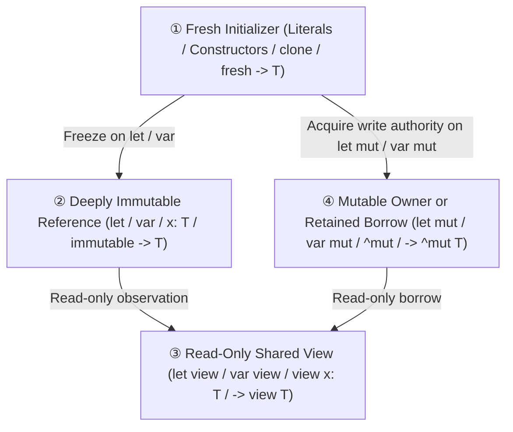
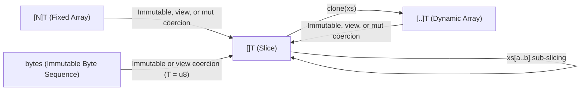

# Ril Sequence Types & Built-In Collection Specifications

## 1. Sequence Types Overview & Taxonomy

Ril partitions contiguous linear sequences into three orthogonal built-in types based on **length mutability** and **ownership**:

| Type | Name | Length Semantics | `mut` Capability | Memory Representation |
| :--- | :--- | :--- | :--- | :--- |
| **`[N]T`** | **Fixed Array** | Compile-time constant `N` ($N \ge 0$) | **In-place element mutation only** | Inline contiguous elements ($N \times \text{sizeof}(T)$) |
| **`[]T`** | **Slice** | Runtime-fixed length; **cannot resize** | **In-place element mutation only** | Fat pointer `(data_ptr, len)` (2 words, zero heap allocation) |
| **`[..]T`** | **Dynamic Array** | Runtime-variable length; **growable** | **Structural resize + in-place element mutation** | Managed buffer `(data_ptr, len, cap)` |

### Core Design Principles
1. **Separation of Element Mutation and Structural Resizing**: `mut []T` and `mut [N]T` permit mutating existing element slots in place (`xs[i] = v`) but statically forbid changing length. Only `mut [..]T` permits structural length changes.
2. **Immutable by Default, Explicit `view` and `mut`**: Unmodified types and bindings (`let x: T`, `var x: T`, `fn f(x: T)`, `{ field: T }`, `[..]T`) are **deeply immutable by default** (eliminating `Immut<T>` and `clone_immut`). Read-only shared views that may observe mutable storage use **`view`**, and write access uses **`mut`** / **`^mut`**.
3. **Ergonomic Slice Signatures (`[]T`, `view []T`, `mut []T`)**: Functions that require permanent deep immutability accept `[]T`; functions that only inspect elements accept `view []T` (admitting both immutable and mutable `[N]T`, `[..]T`, and `[]T` with zero copying); functions that mutate elements in place without resizing accept `mut []T`.

---

## 2. Orthogonal Binding, Parameter & Return Provenance Model

### 2.1 The 2 × 3 Orthogonal Binding Matrix

Local variable declarations separate **slot reassignability** (`let` vs. `var`) from **data permission & sharing** (default immutable vs. `view` vs. `mut`):

| Data Permission \ Slot Kind | `let` (Pinned slot: cannot `x = ...`) | `var` (Reassignable slot: can `x = ...`) | Semantics & Guarantees |
| :--- | :--- | :--- | :--- |
| **Default (Deeply Immutable)** | **`let x: T`** | **`var x: T`** | **True deep immutability**. Entire reachable graph has no surviving writer; freely shareable across tasks and storable in immutable aggregates. |
| **`view` (Read-Only Shared View)** | **`let view x: T`** | **`var view x: T`** | **Read-only view**. Accepts **both** deeply immutable (`let`/`var`) and mutable (`let mut`/`var mut`) sources. Forbids interior writes through `x` and cannot freeze into `let`/`var` without `clone`. |
| **`mut` (Mutable Authority)** | **`let mut x: T`** | **`var mut x: T`** | **Interior/element write permission** (for reference/sequence types; primitive scalars use plain `var`). Subject to exclusivity (`E0523`/`E0524`). |

### 2.2 The 4-State Reference & Permission Lattice

All values and references flow through a four-state permission model:



* **① Fresh Initializer (`-> T`)**: Newly allocated literals (`[1, 2, 3]`), constructors (`Cell.{ count: 0 }`), `clone(view x) -> T`, and functions returning `-> T` whose result is freshly constructed inside the function with no surviving aliases.
  * Can freeze into **② Deeply Immutable (`let` / `var`)** or acquire write authority as **④ Mutable (`let mut` / `var mut`)**.
  * **Cannot bind directly to `let view` / `var view`**: a fresh unowned initializer has no existing host variable to observe (just as `let view v = [1, 2, 3]` is prohibited).
* **② Deeply Immutable Reference (`-> T`)**: Bound `let` / `var` variables, default-immutable parameters (`x: T`), and functions returning `-> T` whose result projects or slices from an immutable origin or internally frozen `let` binding.
  * Can bind to **`let` / `var`** (freely shared immutable reference) or widen to **`let view` / `var view`** (read-only view over existing immutable storage).
  * **Cannot bind to `let mut` / `var mut` (`E0528`)**: an already-frozen immutable reference can never regain write authority.
* **③ Read-Only Shared View (`view T` / `-> view(p) T`)**: Bound `let view` / `var view` variables, `view` parameters, and read-only slices/projections of mutable or view storage.
  * Can bind to **`let view` / `var view`** (or upgrade to **`let` / `var` via Provenance Passthrough** when all origin arguments at a call site are deeply immutable).
  * Cannot flow upward into `let` / `var` (`E0535`) or `let mut` / `var mut` (`E0520`) without an explicit `clone`.
* **④ Mutable Owner / Retained Borrow (`mut T` / `^mut T` / `-> ^mut(p) T`)**: Bound `let mut` / `var mut` variables, local `^mut` borrows, and functions returning writable sub-slices or aliases borrowed from mutable parameters.
  * Can bind to **`let mut` / `var mut`** (within the host's exclusivity window) or downgrade to **`let view` / `var view`**.
  * Cannot bind to `let` / `var` (`E0535`) while the backing owner remains mutable.
* **Elimination of `Immut<T>` and `clone_immut`**:
  * Because unmodified `T` is deeply immutable by default across bindings, parameters, record/variant fields (`{ child: Cell, data: []int }`), and container elements (`let mut snaps: [..][]int`), the wrapper type `Immut<T>` is completely removed.
  * **Field Slot Mutability vs. Child Object Mutability**:
    * In a record declaration `{ mut count: int, child: Cell, mut active: mut Cell }`, `mut` before the **field label** (`mut count`, `mut active`) grants permission to **replace that field's slot** (`r.count = 1`, `r.active = new_cell`) when the record is mutable.
    * The modifier before the **constituent type** (`Cell` vs. `view Cell` vs. `mut Cell`, or `[..]Cell` vs. `[..]mut Cell`) governs the **interior permission of the child reference**: unmodified `Cell` is deeply immutable even inside a `let mut` container/record; `view Cell` is a read-only shared view; `mut Cell` permits interior mutation of the child (`r.active.count += 1` or `cells[i].count += 1`) when accessed through a mutable path.
    * When a container with mutable elements (`[..]mut T`, `[N]mut T`, `[K: mut V]`) is accessed through a read-only `view`, its element type `mut T` is observed as **`view T`** (preventing mutable elements from being laundered into deeply immutable `T`).
  * A single built-in prelude `clone<T>(view value: T) -> T` replaces `clone_immut` and returns a **State ① Fresh Initializer**: binding `let snap = clone(observed)` freezes the fresh copy as deeply immutable, `let mut copy = clone(observed)` acquires mutable authority, and `clone(observed) |> derive \mut d -> ...` freezes the result directly into `derive`.

### 2.3 Function Parameter Modes

| Parameter Form | Caller Argument | Meaning Inside Callee |
| :--- | :--- | :--- |
| **`x: T`** (Default) | Deeply immutable (`let`, `var`, or `Fresh`) | **Deeply immutable (`let` semantics)**. Can be sliced into `let`, stored in immutable structures, returned as `-> T`, or shared across tasks. |
| **`view x: T`** | Immutable (`let`/`var`), view (`let view`/`var view`), or mutable (`let mut`/`var mut`) | **Read-only shared view (`let view` semantics)**. Can be read, iterated, or sub-sliced into `let view` / `var view`, without copying. |
| **`mut x: T`** | `mut target` (or `target !> f()`) | **Temporary mutable borrow**. Grants in-place interior/element writes; cannot be retained after return unless returned via `-> ^mut`. |
| **`^mut x: T`** | `^mut target` | **Retained mutable borrow**. Grants write access plus permission to retain/return a writable alias (`&^mut`). |

### 2.4 Function Return Provenance & the 4-State Model

Function return annotations avoid misleading `-> mut T` modifiers on fresh values while distinguishing all four reference states:

| State | Return Signature | Value Provenance | Allowed Caller Bindings | Prohibited Caller Bindings | Examples |
| :--- | :--- | :--- | :--- | :--- | :--- |
| **① Fresh Initializer** | **`-> T`** | Newly constructed inside callee; not frozen by `let`/`var`; no surviving external aliases. | **`let`, `var`** (freeze)<br/>**`let mut`, `var mut`** (keep writable) | **`let view`, `var view`** *(no existing host variable to observe)* | `fn clone<T>(view x: T) -> T`<br/>`fn make_buf() -> [..]u8`<br/>`fn build_cell() -> Cell` |
| **② Deeply Immutable Reference** | **`-> T`** | Projected/sliced from a default-immutable parameter (`x: T`), module-level `let`, internal `let`-frozen binding, or `.d.ril` declaration. | **`let`, `var`** (share immutable ref)<br/>**`let view`, `var view`** (observe existing ref) | **`let mut`, `var mut`** (`E0528`: already frozen) | `fn tail(xs: []int) -> []int`<br/>`fn get_cell(h: Holder) -> Cell`<br/>`fn shared_pair() -> (Cell, Cell)` |
| **③ Read-Only Shared View** | **`-> view T`**<br/>**`-> view(p1, ...) T`** | Read-only slice or projection borrowed from `view` or `mut` origin parameter(s). | **`let view`, `var view`**<br/>*(plus **`let`, `var`** via Provenance Passthrough when all origin args are deeply immutable)* | **`let mut`, `var mut`** (`E0520`)<br/>**`let`, `var`** (`E0535` when any origin is mutable/view) | `fn first_half(view xs: []int) -> view []int`<br/>`fn longest(view a: []u8, view b: []u8) -> view(a, b) []u8` |
| **④ Retained Mutable Borrow** | **`-> ^mut T`**<br/>**`-> ^mut(p) T`** | Writable sub-slice or reference borrowed from mutable parameter `p` (`&mut` or `&^mut`). | **`let mut`, `var mut`** (mutate in place)<br/>**`let view`, `var view`** (downgrade to view) | **`let`, `var`** (`E0535`: backing owner remains mutable) | `fn head_mut(mut xs: []int) -> ^mut []int &mut`<br/>`fn retain(^mut c: Cell) -> ^mut(c) Cell &^mut` |

#### Distinguishing State ① (Fresh Initializer) and State ② (Deeply Immutable Reference) Under `-> T`
Both fresh initializers and deeply immutable references use the clean return syntax `-> T` without needing `(p)` origin annotations (since neither can ever lock a caller's mutable variable). Complete Provenance distinguishes them automatically:
```ril
-- State ①: Fresh Initializer (newly constructed inside the function, never frozen)
fn build_cell(n: int) -> Cell {
    let mut c = Cell.{ count: n }
    c.count += 1
    c
}

let a = build_cell(1)            -- OK: freezes into State ② (Deeply Immutable)
let mut b = build_cell(1)        -- OK: acquires write authority as State ④ (Mutable)
-- let view v = build_cell(1)    -- Error: fresh initializer has no host variable to view

-- State ②: Deeply Immutable Reference (projected from immutable parameter or frozen let)
fn get_cell(h: Holder) -> Cell { h.cell }
fn tail(xs: []int) -> []int { xs[1..] }
fn shared_pair() -> (Cell, Cell) {
    let c = Cell.{ count: 1 }    -- Frozen by 'let' because 'c' is shared in two slots
    (c, c)
}

let c1 = get_cell(holder)        -- OK: deeply immutable reference
let view v1 = get_cell(holder)   -- OK: read-only view over existing immutable reference
-- let mut m1 = get_cell(holder) -- Error (E0528): cannot mutably bind an already-frozen reference
```

#### Rules for Return `view` and `^mut` Origins
1. **Single-Source Elision (`-> view T` / `-> ^mut T`)**: When a function signature has exactly one `view`, `mut`, or `^mut` parameter, writing `-> view T` or `-> ^mut T` automatically binds the returned reference's origin to that sole parameter:
   ```ril
   fn first_half(view xs: []int) -> view []int {
       xs[..len(xs) / 2]
   }

   fn head_mut(mut xs: []int) -> ^mut []int &mut {
       ^mut xs[..1]
   }
   ```
2. **Multi-Source Explicit Naming (`-> view(p1, p2) T` / `-> ^mut(p) T`)**: When a function has multiple `view`, `mut`, or `^mut` parameters, parenthesized parameter names identify the exact origin set:
   ```ril
   -- Borrows exclusively from 'haystack'; 'needle' is free immediately after the call!
   fn find_window(view haystack: []u8, view needle: []u8) -> ?view(haystack) []u8

   -- May return a view from either 'a' or 'b' (tracks the union of both origins):
   fn longest(view a: []u8, view b: []u8) -> view(a, b) []u8 {
       if len(a) >= len(b) { a } else { b }
   }
   ```
3. **Component-Level Precision in Composite Returns & Callable Types**: In tuple, record, `Option`, or `Result` return types, `view(...)` and `^mut(...)` may annotate specific constituents without polluting independent fields. Higher-order callable types (`fn(...) -> ...`) use the same syntax:
   ```ril
   fn next_token(view input: []u8) -> (Token, view []u8)
   fn trim_both(view a: []u8, view b: []u8) -> (view(a) []u8, view(b) []u8)
   fn split_mid(mut xs: []int) -> (^mut(xs) []int, ^mut(xs) []int) &mut
   type Matcher = fn(view haystack: []u8, view needle: []u8) -> ?view(haystack) []u8
   ```
4. **External / Captured State Origins**: When a returned view borrows from module-level or closure-captured storage declared in `&{...}`, name that storage in `view(...)`:
   ```ril
   let mut global_buf: [..]u8 = []
   fn current_bytes() -> view(global_buf) []u8 &{global_buf} {
       global_buf[..]
   }
   ```
5. **Provenance Passthrough (Zero Signature Duplication)**: Because `-> view(p) T` records the exact dependency on `p`, calling the function with **deeply immutable (`let` / `var` / `Fresh`) actual arguments** for all listed origins automatically upgrades the returned value to **State ② (Deeply Immutable Reference)**, allowing the caller to bind it directly to `let` or `var`:
   ```ril
   let imm_arr = [1, 2, 3, 4]
   let sub = first_half(imm_arr)        -- OK: 'imm_arr' is deeply immutable, so 'sub' is State ②!

   let mut mut_arr = [1, 2, 3, 4]
   let view v = first_half(mut_arr)     -- OK: 'mut_arr' is mutable, so 'v' is State ③ locking 'mut_arr'
   ```

---

## 3. Sequence Syntax, Type Inference & Coercion

### 3.1 Grammar

```ebnf
ArrayType           ::= "[" [ ".." | Expression ] "]" TypeExpression
ArrayPattern        ::= "[" [ ArrayPatternElement { "," ArrayPatternElement } [ "," ] ] "]"
ArrayPatternElement ::= Pattern | ".." [ [ BindingModifier ] Identifier ]
BindingModifier     ::= "view" | "mut" | "var" [ "view" | "mut" ]
ParameterMode       ::= "view" | "mut" | "^mut"
ReturnTypeMode      ::= ( "view" | "^mut" ) [ "(" Identifier { "," Identifier } ")" ]
ConstituentTypeMode ::= "view" | "mut" | "^mut"
```

* `[N]T`: Fixed array of compile-time `int` length `N` (`N < 0` triggers `E0815`; non-`int` triggers `E0323`; non-const triggers `E0814`).
* `[]T`: Fixed-length slice over contiguous elements of type `T`.
* `[..]T`: Growable dynamic array of elements of type `T`.
* `..rest` / `..view rest` / `..mut rest`: Named array pattern rest binding a zero-copy slice `[]T` over the remaining element slots.

### 3.2 Array Literal Inference (`[e1, e2, ...]`)

| Context | Inferred Type | Example |
| :--- | :--- | :--- |
| Expected type is `[N]T` | `[N]T` (arity checked at compile time) | `let buf: [4]u8 = [0, 0, 0, 0]` |
| Expected type is `[]T` | `[]T` | `var s: []int = [1, 2, 3]; s = s[1..]` |
| Expected type is `[..]T` or **unconstrained** | **`[..]T`** (Fresh) | `let xs = [1, 2, 3]` (immutable `[..]int`)<br/>`let mut ys = [1, 2, 3]` (mutable `[..]int`) |

> **Rationale**: Defaulting unconstrained array literals to fresh `[..]T` allows `let mut ys = [1, 2, 3]` to be grown in place without type annotations, freezes `let xs = [1, 2, 3]` as deeply immutable, and passes seamlessly to any `[]T` or `view []T` parameter via implicit coercion.

### 3.3 Sequence Coercion & Subtyping Rules

Element type `T` is invariant across all three sequence types. Zero-copy slice coercion follows a strict one-way funnel into `[]T`:



| Source $\to$ Target | Immutable (`T`) | Shared View (`view T`) | Mutable (`mut T`) | Semantics |
| :--- | :---: | :---: | :---: | :--- |
| `[N]T` $\to$ `[]T` | Allowed (from `let`/`var`) | Allowed (from any `[N]T`) | Allowed (`mut [N]T` $\to$ `mut []T`) | Zero-copy whole-sequence window `arr[0..N]` |
| `[..]T` $\to$ `[]T` | Allowed (from `let`/`var`) | Allowed (from any `[..]T`) | Allowed (`mut [..]T` $\to$ `mut []T`) | Zero-copy whole-sequence window `arr[0..len(arr)]` |
| `bytes` $\to$ `[]u8` | Allowed | Allowed | **Rejected (`E0520`)** | Zero-copy read-only byte slice view |
| `[]T` $\to$ `[..]T` | **Rejected (`E0301`)** | **Rejected (`E0301`)** | **Rejected (`E0301`)** | Slices lack capacity/ownership; use `clone` |
| `[]T` $\to$ `[N]T` | **Rejected (`E0301`)** | **Rejected (`E0301`)** | **Rejected (`E0301`)** | Runtime length cannot satisfy compile-time fixed length |
| `[N]T` $\to$ `[..]T` | **Rejected (`E0301`)** | **Rejected (`E0301`)** | **Rejected (`E0301`)** | Fixed arrays cannot resize; convert explicitly |

---

## 4. Slicing, Pattern Destructuring & Cursor Rebinding

### 4.1 Range Slicing (`arr[a..b]`)

Slicing any sequence (`[N]T`, `[..]T`, or `[]T`) with a range expression `arr[a..b]` or `arr[a..=b]` always yields static type **`[]T`**. It evaluates `arr` and the bounds once and creates a zero-copy window over the selected elements.

The permitted binding mode follows the diamond permission lattice:

| Source Provenance | Desired Access | Permitted Forms | Rules & Guarantees |
| :--- | :--- | :--- | :--- |
| **Deeply Immutable (`let` / `var`)** | Deeply immutable or View | `let s = arr[a..b]`<br/>`var s = arr[a..b]`<br/>`let view s = arr[a..b]`<br/>`var view s = arr[a..b]` | **Deeply immutable slice**. No writers exist; `let s` and `var s` can be freely shared across tasks, stored in immutable aggregates, or widened to `view`. |
| **View (`let view` / `var view`)** or<br/>**Mutable (`let mut` / `var mut`)** | Read-only shared observation | `let view s = arr[a..b]`<br/>`var view s = arr[a..b]`<br/>`f(arr[a..b])` (for `view` param) | **Read-only live view**. Plain `let` / `var` is rejected (`E0535`: source is not deeply immutable). In-place element writes on a mutable `arr` remain visible through `s`. |
| **Mutable (`let mut` / `var mut`)** | Temporary mutable argument | `f(mut arr[a..b])` | **Scoped mutable slice loan**. `f` receives `mut []T`: it may mutate elements in `a..b` in place, cannot resize, and holds exclusive access to `arr` for the call. |
| **Mutable (`let mut` / `var mut`)** | Local mutable slice handle | `let mut s = ^mut arr[a..b]`<br/>or pattern `[mut head, ..mut tail]` | **Pinned mutable slice**. Permits `s[i] = v` in-place writes. Resizing `s` is rejected by type (`[]T`). |

### 4.2 Reassignable Slice Cursors (`var` and `var view`)

Both immutable and live-view slices support cursor rebinding (`s = s[1..]`) under symmetric rules:

1. **Immutable Slice Cursor (`var s: []T`)**:
   * Every value assigned to `s` must be deeply immutable. Because the backing store is permanently frozen, rebinding `s` imposes zero structural-stability locks:
     ```ril
     let data = [10, 20, 30, 40]
     var cursor = data[..]
     while len(cursor) > 0 {
         cursor = cursor[1..]           -- OK: advances deeply immutable slice cursor
     }
     ```
2. **Shared View Slice Cursor (`var view s: []T`)**:
   * Accepts slices from mutable (`let mut` / `var mut`), view (`let view` / `var view`), or immutable (`let` / `var`) sources:
     ```ril
     let mut buf = [10, 20, 30, 40]
     var view cursor = buf[..]
     while len(cursor) > 0 {
         cursor = cursor[1..]           -- OK: advances live view cursor over mutable 'buf'
     }
     buf[0] = 99                        -- OK: 'cursor' has no subsequent uses after the loop
     ```
   * **Conservative Union Origin Tracking**: Across branches and loops, `var view s` tracks the union of possible backing origins currently reachable by `s`. While `s` has a statically possible subsequent use, every possible mutable origin in its current origin set must obey structural stability (`E0537`).

### 4.3 Array Pattern Matching & Rest Windows (`..rest`, `..view rest`, `..mut rest`)
* **Unified Slice Type for Rest Bindings**: Regardless of whether the matched subject has type `[N]T`, `[]T`, or `[..]T`, a named rest pattern binds a zero-copy slice of static type **`[]T`** over the remaining element slots (replacing the legacy rule where `[N]T` produced a `[N-k]T` window).
  * Matching an immutable subject binds `..rest` as deeply immutable `[]T`.
  * Matching a `view` or `mut` subject for read-only inspection binds `..view rest` (or `..rest` inferred as a view).
* **Disjoint Mutable Destructuring (`..mut rest`)**: When matching against a mutable sequence (`mut [N]T`, `mut []T`, or `mut [..]T`), prefix/suffix element bindings and `..mut rest` establish statically disjoint writable origins:
  ```ril
  fn normalize_head(mut xs: []mut Cell) &mut {
      match mut xs {
          [] -> (),
          [mut head, ..mut tail] -> {
              -- 'head' (element 0) and 'tail' ([]mut Cell over 1..len) are statically disjoint!
              head.count = len(tail)
              var i = 0
              while i < len(tail) {
                  tail[i].count += head.count
                  i += 1
              }
          }
      }
  }
  ```

---

## 5. Exclusivity & Structural Stability Invariants

### 5.1 Structural Stability & Origin Pinning (`E0537`)
While any live slice or view (`let view`, `var view`, or `let mut` slice) derived from a mutable origin remains active (has a statically possible subsequent use):
1. **No Structural Resizing (`E0537`)**: If the origin is a dynamic array `[..]T`, all structural length-changing mutations on that origin are statically rejected (`E0537`).
2. **No Origin Slot Replacement (`E0537`)**: If the origin is held in a reassignable `var mut` binding, reassigning that `var mut` slot (`arr = new_arr`) while the derived view remains active is likewise rejected (`E0537`).
3. **Automatic Release on Last Use**: Once the last use of the view/slice and all its aliases completes, the underlying `[..]T` or `var mut` binding immediately regains full structural mutation and reassignment authority.

### 5.2 Law of Exclusivity (`E0523` / `E0524`) & Disjoint Splitting
* **Live Read-Only View (`let view s` / `var view s`)**: The owner `arr` may still perform same-length in-place element replacements (`arr[i] = v`), which `s` observes live, provided no overlapping mutable loan is active simultaneously.
* **Mutable Slice (`mut arr[a..b]`)**: Obeys strict read/write and write/write exclusivity (`E0523` / `E0524`). Because arbitrary runtime ranges `arr[a..b]` and `arr[c..d]` cannot be statically proven disjoint, borrowing two mutable slices directly from the same `arr` at the same time triggers `E0523`.
* **Disjoint Mutable Destructuring**: Slice pattern destructuring (`[mut head, ..mut tail]`, `[..mut init, mut last]`) or functions returning disjoint mutable borrows `(^mut(xs) []T, ^mut(xs) []T)` establish statically disjoint writable origins tied to `xs`.

### 5.3 Concurrency & Escape Confinement (`E0601`)
* Deeply immutable slices (`let s: []T`, `var s: []T`) can freely cross concurrent task boundaries and be stored in immutable heap structures.
* Live slice views (`let view`, `var view`) and mutable slices (`let mut s: []T`) cannot cross concurrent task boundaries (`E0601`) or be stored into deeply immutable aggregates (`E0535`).
* To detach a view or mutable slice into an independent heap buffer, explicitly materialize it via built-in `clone(s)`.

---

## 6. Built-In `bytes`, `str`, `Map`, and Prelude `len` Specifications

### 6.1 `bytes`: Zero-Copy Coercion & Direct Indexing/Slicing
* **Zero-Copy Coercion (`bytes` $\to$ `[]u8` / `view []u8`)**:
  * `bytes` remains an immutable primitive value type (admissible as a `Map` key, const generic argument, and ordered via `<`, `<=`, `>`, `>=`).
  * In any position expecting `[]u8` or `view []u8`, a `bytes` value **implicitly coerces to an immutable `[]u8` slice** in $O(1)$ time with zero heap allocation.
* **Direct Indexing and Slicing**:
  * `b[i]` returns `u8` (panics if `i < 0` or `i >= len(b)`).
  * `b?[i]` returns `?u8` (`None` if out of bounds).
  * `b[a..b]` and `b[a..=b]` return a zero-copy `bytes` sub-slice (panicking on invalid bounds); `b?[a..b]` returns `?bytes`.

### 6.2 `str`: Built-In Zero-Allocation Iteration & $O(1)$ Byte-Offset Slicing
* **Direct Zero-Allocation `for` Iteration over `str`**:
  * `str` is admitted directly as a built-in `for` iterable source:
    ```ril
    for text as scalar {
        -- 'scalar' has type u32 (decoded Unicode scalar value in source order)
    }
    ```
  * Decodes UTF-8 scalars on the fly in registers with $O(1)$ state and **zero heap allocation**.
* **$O(1)$ UTF-8 Byte-Offset Slicing (`s[a..b]` & `s?[a..b]`)**:
  * Slicing a string `s[a..b]` (or `s[a..=b]`) operates on **UTF-8 byte offsets** in $O(1)$ time, returning a zero-copy `str` view.
  * Bounds must lie within `0..=byte_len` and on valid UTF-8 scalar boundaries (checked in $O(1)$ via `(byte & 0xC0) != 0x80`).
  * Out-of-range or mid-codepoint bounds trigger a deterministic runtime panic in `s[a..b]`, or evaluate to `None` (`?str`) in safe slicing `s?[a..b]`.
  * Single-integer bracket indexing `s[i]` on `str` remains prohibited (`E0352`) to prevent confusion between bytes and Unicode scalars.

### 6.3 `Map` (`[K: V]`): Composite Keys & Symmetric Bracket Operators

#### A. Immutable Acyclic Composite Keys (`E0328` & `E0535`)
A type `K` is **Key-Eligible** for `[K: V]` if and only if:
1. **Structural Acyclicity & Constituent Eligibility**:
   * `K` is `bool`, `i8`..`i64`, `int`, `u8`..`u64`, `bigint`, `str`, `bytes`, or `()`; OR
   * `K` is a **non-recursive** Sum Type, closed Record, Tuple, Fixed Array `[N]E`, or Nominal/Opaque wrapper whose constituent fields/elements/payloads are all recursively Key-Eligible.
   * Floating-point types (`f32`, `f64`), dynamic arrays (`[..]T`), slices (`[]T`), maps, callables, and resources remain ineligible (`E0328`).
2. **Deep Immutability Requirement (`E0535`)**:
   * Any key inserted into `[K: V]` or used in a lookup/`in` test MUST be proven **deeply immutable** (default immutable mode `let` / `var` / `K`). Passing a live mutable reference or a `view` (`let view` / `var view`) as a key is rejected with `E0535`.

```ril
type HttpMethod { Get, Post, Put, Delete }
type RouteKey = (HttpMethod, str)

let routes: [RouteKey: int] = [
    (HttpMethod::Get, "/health"): 200,
    (HttpMethod::Post, "/items"): 201,
]
assert(routes?[(HttpMethod::Get, "/health")] == Some(200))
assert((HttpMethod::Get, "/health") in routes)
```

#### B. Symmetric Bracket Indexing & Slot Assignment (`m?[k]`, `m[k]`, `m[k] = v`)
`Map` bracket operators align strictly with `Array` and `Slice`:

| Expression | Receiver | Result Type | Behavior |
| :--- | :--- | :--- | :--- |
| **`m?[k]`** | `[K: V]` or `?[K: V]` | **`?V`** (or `?view V` when viewing `[K: mut V]`) | **Safe lookup**: returns `Some(v)` if `k` is present, or `None` if absent (or receiver is `None`). |
| **`m[k]`** | `[K: V]` | **`V`** (or `view V` when viewing `[K: mut V]`) | **Assertive lookup**: returns `v` directly if `k` is present; **panics** if `k` is absent. |
| **`m[k] = v`** | `mut [K: V]` | **`()`** | **In-place slot assignment**: inserts or replaces the value for `k` (preserving existing key order on replacement, including fresh-value storage reception). |

```ril
let mut counts: [str: int] = ["a": 1]
let maybe_b: ?int = counts?["b"]       -- None
let a_val: int = counts["a"]           -- 1 (panics if missing)
counts["b"] = (counts?["b"] ?? 0) + 1  -- Inserts "b": 1
counts["a"] += 10                      -- Compound assignment updates "a" to 11
```

### 6.4 Built-In Prelude `len` Coverage
The built-in prelude `len(view value) -> int` operation ($O(1)$) covers all built-in sequence and map types (whether immutable, view, or mutable):
* `[N]T`, `[]T`, `[..]T`: element count
* `[K: V]`: entry count
* `bytes`: byte length

---

## 7. Compiler Representation & Optimizations

| Construct | Lowered Representation | Key Compiler Optimizations |
| :--- | :--- | :--- |
| **`[N]T`** | Contiguous inline block of $N \times \text{sizeof}(T)$ bytes; no runtime header | **Stack Allocation**: Allocated on the stack frame when non-escaping (including when coerced to `view []T` or `mut []T` for downward calls).<br/>**Inline Flattening**: Nested arrays (`[4][4]f32`) and record fields flatten into a single allocation.<br/>**Static BCE & SIMD**: Compile-time bounds check elimination and loop auto-vectorization. |
| **`[]T`** | 2-word fat pointer `(data_ptr, len)` (with GC base-object tracking for interior pointers) | **Zero Heap Allocation**: `arr[a..b]` compiles to bounds check + pointer offset (`ptr + a * stride`) + length subtraction (`b - a`).<br/>**Register ABI (SROA)**: Passed and returned directly in two CPU registers.<br/>**Polymorphism-Free**: Uniform layout regardless of whether the backing store is stack `[N]T`, heap `[..]T`, or `bytes`. |
| **`[..]T`** | Managed header `(data_ptr, len, cap)` pointing to a geometrically growable heap buffer | **Pointer & Length Hoisting (LICM)**: Because `E0537` and `mut []T` statically forbid reallocation during active borrows/loops, `data_ptr` and `len` are cached in registers without reloading from memory after calls.<br/>**Exact Literal Pre-allocation**: `[e1, ..., ek]` allocates exact initial capacity $k$ in one step. |
