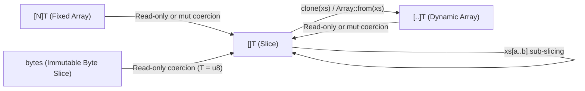

# Ril Sequence Types & Foundational Data Structures Design

## 1. Sequence Types Overview & Taxonomy

Ril partitions contiguous linear sequences into three orthogonal types based on **length mutability** and **ownership**:

| Type | Name | Length Semantics | `mut` Capability | Memory Representation |
| :--- | :--- | :--- | :--- | :--- |
| **`[N]T`** | **Fixed Array** | Compile-time constant `N` ($N \ge 0$) | **In-place element mutation only** | Inline contiguous elements ($N \times \text{sizeof}(T)$) |
| **`[]T`** | **Slice** | Runtime-fixed length; **cannot resize** | **In-place element mutation only** | Fat pointer `(data_ptr, len)` (2 words, zero heap allocation) |
| **`[..]T`** | **Dynamic Array** | Runtime-variable length; **growable** | **Structural resize (`push`/`pop`) + in-place element mutation** | Managed buffer `(data_ptr, len, cap)` |

### Core Design Principles
1. **Separation of Element Mutation and Structural Resizing**: `mut []T` and `mut [N]T` permit mutating existing element slots in place (`xs[i] = v`) but statically forbid changing length. Only `mut [..]T` permits structural changes (`push`, `pop`, `insert`, `remove`, `truncate`).
2. **Ergonomic Default for Signatures (`[]T`)**: Functions that read or mutate elements in place without resizing accept `[]T` or `mut []T`. Both `[N]T` and `[..]T` coerce implicitly to `[]T` with zero copying.
3. **Strict Distinction Between Immutable (`let`) and Read-Only (`let view`)**: `let` guarantees deep immutability (no surviving writers exist). A read-only slice over a mutable source (`let mut`) is **read-only, not immutable**, and MUST be bound with `let view`.

---

## 2. Sequence Syntax & Type Inference

### 2.1 Grammar

```ebnf
ArrayType           ::= "[" [ ".." | Expression ] "]" TypeExpression
ArrayPattern        ::= "[" [ ArrayPatternElement { "," ArrayPatternElement } [ "," ] ] "]"
ArrayPatternElement ::= Pattern | ".." [ [ "mut" ] Identifier ]
```

* `[N]T`: Fixed array of compile-time `int` length `N` (`N < 0` triggers `E0815`; non-`int` triggers `E0323`; non-const triggers `E0814`).
* `[]T`: Fixed-length slice over contiguous elements of type `T`.
* `[..]T`: Growable dynamic array of elements of type `T`.
* `..rest` / `..mut rest`: Named array pattern rest binding a zero-copy slice `[]T` over the remaining element slots.

### 2.2 Array Literal Inference (`[e1, e2, ...]`)

| Context | Inferred Type | Example |
| :--- | :--- | :--- |
| Expected type is `[N]T` | `[N]T` (arity checked at compile time) | `let buf: [4]u8 = [0, 0, 0, 0]` |
| Expected type is `[]T` | `[]T` | `fn sum(xs: []int)` called as `sum([1, 2, 3])` |
| Expected type is `[..]T` or **unconstrained** | **`[..]T`** | `let mut xs = [1, 2, 3]` (inferred as `[..]int`) |

> **Rationale**: Defaulting unconstrained array literals to `[..]T` allows `let mut xs = [1, 2, 3]; xs !> Array::push(4)` without type annotations, while still passing seamlessly to any `[]T` parameter via implicit coercion.

---

## 3. Sequence Coercion & Subtyping Rules

Element type `T` is invariant across all three sequence types. Zero-copy view coercion follows a strict one-way funnel into `[]T`:



| Source $\to$ Target | Read-Only (`T`) | Mutable (`mut T`) | Semantics |
| :--- | :---: | :---: | :--- |
| `[N]T` $\to$ `[]T` | Allowed | Allowed (`mut [N]T` $\to$ `mut []T`) | Zero-copy whole-sequence window `arr[0..N]` |
| `[..]T` $\to$ `[]T` | Allowed | Allowed (`mut [..]T` $\to$ `mut []T`) | Zero-copy whole-sequence window `arr[0..len(arr)]` |
| `bytes` $\to$ `[]u8` | Allowed | **Rejected (`E0520`)** | Zero-copy read-only byte slice view |
| `[]T` $\to$ `[..]T` | **Rejected (`E0301`)** | **Rejected (`E0301`)** | Slices lack capacity/ownership; use `clone` or `Array::from` |
| `[]T` $\to$ `[N]T` | **Rejected (`E0301`)** | **Rejected (`E0301`)** | Runtime length cannot satisfy compile-time fixed length |
| `[N]T` $\to$ `[..]T` | **Rejected (`E0301`)** | **Rejected (`E0301`)** | Fixed arrays cannot resize; convert explicitly |

---

## 4. Slicing, Pattern Destructuring & Binding Permissions

### 4.1 Range Slicing (`arr[a..b]`)

Slicing any sequence (`[N]T`, `[..]T`, or `[]T`) with a range expression `arr[a..b]` or `arr[a..=b]` always yields static type **`[]T`**. It evaluates `arr` and the bounds once and creates a zero-copy window over the selected elements.

The permitted binding mode depends strictly on the provenance of the source array:

| Source Provenance | Desired Access | Required Form | Rules & Guarantees |
| :--- | :--- | :--- | :--- |
| **Immutable (`let`)** | Immutable | `let s = arr[a..b]` | **Deeply immutable (`Immut`)**. No writers exist; `s` can be shared freely across tasks (`s.fork`) and stored in immutable aggregates. `let view` is rejected (`E0531`). |
| **Mutable (`let mut`)** | Read-only live observation | `let view s = arr[a..b]` | **Read-only live view**. `let` is rejected (`E0535`: surviving writer). `var` is rejected (`E0531`: live views must be pinned). In-place element writes on `arr` remain visible through `s`. |
| **Mutable (`let mut`)** | Temporary mutable argument | `f(mut arr[a..b])` | **Scoped mutable slice loan**. `f` receives `mut []T`: it may mutate elements in `a..b` in place, cannot resize, and holds exclusive access to `arr` for the duration of the call. |
| **Mutable (`let mut`)** | Local mutable slice handle | `let mut s = ^mut arr[a..b]`<br/>or `Array::split_at(mut arr, mid)` | **Pinned mutable slice**. Permits `s[i] = v` in-place writes. Rebinding `s` is rejected (`E0502`). Resizing `s` is rejected by type (`[]T`). |

### 4.2 Why `var` is Prohibited on Live Slice Views
* A slice derived from a `let mut` source is a **live view**, not an independent value.
* Allowing `var s = mut_arr[a..b]` would conceal its live-view nature (losing the explicit `view` marker) and force static provenance analysis to conservatively lock the structural stability (`E0537`) of every array ever assigned to `s` across loops and branches.
* Cursor iteration over live mutable arrays should use an `int` index (`var i = 0`) or a read-only parameter boundary. (`var` remains valid over deeply immutable `let` slices, as no live writer exists.)

### 4.3 Array Pattern Matching & Rest Windows (`..rest` / `..mut rest`)
* **Unified Slice Type for Rest Bindings**: Regardless of whether the matched subject has type `[N]T`, `[]T`, or `[..]T`, a named rest pattern (`..rest` or `..mut rest`) binds a zero-copy slice of static type **`[]T`** over the remaining element slots (replacing the legacy rule where `[N]T` produced a `[N-k]T` window without copying).
* **Disjoint Mutable Destructuring (`..mut rest`)**: When matching against a mutable sequence (`mut [N]T`, `mut []T`, or `mut [..]T`), prefix/suffix element bindings and `..mut rest` establish statically disjoint origins:
  ```ril
  fn normalize_head(mut xs: []Cell) &mut {
      match mut xs {
          [] -> (),
          [mut head, ..mut tail] -> {
              -- 'head' (element 0) and 'tail' ([]Cell over 1..len) are statically disjoint!
              head.count = len(tail)
              for_each_mut(mut tail, \mut c -> { c.count += head.count })
          }
      }
  }
  ```

---

## 5. Exclusivity & Structural Stability Invariants

### 5.1 Structural Stability (`E0537`)
While any live slice (`let view` or `let mut` slice) derived from a dynamic array `mut_vec: [..]T` remains active (has a statically possible subsequent use), **all structural mutations on `mut_vec` (`push`, `pop`, `insert`, `remove`, `truncate`) are statically rejected (`E0537`)**.
* Once the last use of the slice and its aliases completes, `mut_vec` immediately regains structural mutation authority.
* Fixed arrays `[N]T` and slices `[]T` cannot change length by definition, so `E0537` only applies to `[..]T` origins.

### 5.2 Law of Exclusivity (`E0523` / `E0524`) & Disjoint Splitting
* **Live Read-Only View (`let view s = arr[a..b]`)**: The owner `arr` may still perform in-place element replacements (`arr[i] = v`), which `s` observes live, provided no overlapping mutable loan is active simultaneously.
* **Mutable Slice (`mut arr[a..b]`)**: Obeys strict read/write and write/write exclusivity (`E0523` / `E0524`). Because arbitrary runtime ranges `arr[a..b]` and `arr[c..d]` cannot be statically proven disjoint, borrowing two mutable slices directly from the same `arr` at the same time triggers `E0523`.
* **Disjoint Mutable Splitting (`Array::split_at` & Pattern Matching)**: To obtain multiple simultaneous mutable sub-slices for divide-and-conquer or `Parallel::join`, use `Array::split_at(mut xs, mid) -> ([]T, []T) &mut` or slice pattern destructuring `[mut head, ..mut tail]`, which establish statically disjoint writable origins.

```ril
fn par_quicksort(mut xs: []int) &mut {
    if len(xs) <= 1 { return }
    let pivot = partition(mut xs)
    let (mut left, mut right) = Array::split_at(mut xs, pivot)
    Parallel::join(
        \-> par_quicksort(mut left),
        \-> par_quicksort(mut right),
    )
}
```

### 5.3 Concurrency & Escape Confinement (`E0601`)
* Live slice views (`let view`) and mutable slices (`let mut s: []T`) cannot cross concurrent task boundaries (`s.fork`) or be stored into escaping heap structures (`E0601` / `E0535`).
* To detach a slice into an independent heap buffer, explicitly materialize it via `clone(s)` or `Array::from(s) -> [..]T`.

---

## 6. Container Slot Replacement vs. Element Interior Mutation (`update`)

### 6.1 Problem
In Ril, `var` denotes local variable slot rebinding, whereas `mut` denotes interior memory mutation of a reference object (`E0502` forbids reassigning a `mut` parameter slot, and `E0401` forbids borrowing primitive value types such as `int` or `f64` as `mut` parameters).

Consequently, higher-order in-place combinators of the form:
```ril
pub fn for_each<T>(mut items: []T, action: fn(mut T) -> ()) &mut
```
only support mutating interior fields of reference-type elements (e.g., `[]Cell`) and cannot be instantiated with value-type sequences (`[]int`, `[]f64`) or used to replace immutable reference elements in place.

### 6.2 Design Solution
Strictly separate **Element Interior Mutation** (`fn(mut T) -> ()`) from **Container Slot Replacement** (`fn(T) -> T`):

* **Container Slot Replacement (`update`)**: Mutates the **container's element slot** (`items[i] = transform(items[i])`), which is an interior mutation of the slice `mut items: []T` rather than a `mut` borrow of `T`.
* **Signatures (`ril/array` and `ril/parallel`)**:
  ```ril
  -- ril/array
  pub fn update<T>(mut items: []T, transform: fn(T) -> T) &mut
  pub fn update_indexed<T>(mut items: []T, transform: fn(int, T) -> T) &mut

  -- ril/parallel
  pub fn update<T>(mut items: []T, transform: fn(T) -> T) &mut
  ```
* **Semantics & Invariants**:
  * Works uniformly for all element types `T` (primitive scalars, tuples, records, sum types) without violating `E0401`.
  * Performs zero heap allocations for the outer container, updating each slot `0..len(items)` in place.
  * In `ril/array::update`, `transform` may also use a `mut transform` handle with `&mut` under the standard callback contract. In `ril/parallel::update`, `transform` obeys the pure finite parallel callback contract.

```ril
let mut numbers = [1, 2, 3, 4]
numbers !> Array::update(\x -> x * 10)
assert(numbers == [10, 20, 30, 40])

numbers !> Parallel::update(\x -> x + 1)
assert(numbers == [11, 21, 31, 41])
```

---

## 7. Standard Library (`ril/array` & `ril/parallel`) Conventions

Standard library signatures follow the **Liberal Input (`[]T`), Rich Output (`[..]T`), Explicit Resize (`mut [..]T`)** convention:

```ril
-- 1. Read-Only Queries & Folding (accept []T; compatible with [N]T, [..]T, and slices)
pub fn first<T>(items: []T) -> ?T
pub fn get<T>(items: []T, index: int) -> ?T
pub fn contains<T>(items: []T, value: T) -> bool
pub fn fold<T, A>(items: []T, initial: A, step: fn(A, T) -> A) -> A
pub fn find<T>(items: []T, predicate: fn(T) -> bool) -> ?T
pub fn any<T>(items: []T, predicate: fn(T) -> bool) -> bool
pub fn all<T>(items: []T, predicate: fn(T) -> bool) -> bool
pub fn for_each<T>(items: []T, action: fn(T) -> ())

-- 2. In-Place Element Mutations (accept mut []T; compatible with mut [N]T, mut [..]T, and mut slices)
pub fn swap<T>(mut items: []T, i: int, j: int) &mut
pub fn fill<T>(mut items: []T, value: T) &mut
pub fn update<T>(mut items: []T, transform: fn(T) -> T) &mut
pub fn update_indexed<T>(mut items: []T, transform: fn(int, T) -> T) &mut
pub fn reverse_in_place<T>(mut items: []T) &mut
pub fn sort<T>(mut items: []T) &mut
pub fn split_at<T>(mut items: []T, mid: int) -> ([]T, []T) &mut

-- 3. Allocating Transformations (accept []T, return fresh owned [..]U / [..]T)
pub fn from<T>(items: []T) -> [..]T
pub fn reverse<T>(items: []T) -> [..]T
pub fn concat<T>(left: []T, right: []T) -> [..]T
pub fn map<T, U>(items: []T, transform: fn(T) -> U) -> [..]U
pub fn filter<T>(items: []T, predicate: fn(T) -> bool) -> [..]T

-- 4. Structural Resizing Operations (strictly require mut [..]T)
pub fn push<T>(mut items: [..]T, value: T) &mut
pub fn pop<T>(mut items: [..]T) -> ?T &mut
pub fn insert<T>(mut items: [..]T, index: int, value: T) &mut
pub fn remove<T>(mut items: [..]T, index: int) -> T &mut
pub fn truncate<T>(mut items: [..]T, length: int) &mut

-- 5. Deterministic Data Parallelism (ril/parallel)
pub fn map<T, U>(items: []T, transform: fn(T) -> U) -> [..]U
pub fn update<T>(mut items: []T, transform: fn(T) -> T) &mut
pub fn for_each<T>(mut items: []T, action: fn(mut T) -> ()) &mut
```

---

## 8. Unifying `bytes` and Byte Slices (`[]u8`)

### 8.1 Problem
Previously, `bytes` (an immutable primitive value type) and `[]u8` were disconnected:
1. `bytes` did not support bracket indexing `b[i]`, safe indexing `b?[i]`, or range slicing `b[a..b]`.
2. Standard library byte consumers (`Io::write_all`, `File::write_bytes`, `Unicode::decode_utf8`, `Crypto::sha256_bytes`, `Hex::encode`, `Binary::cursor`) strictly required `bytes`, forcing callers with a stack buffer `[N]u8` or dynamic buffer `[..]u8` to allocate and deep-copy via `Bytes::from_array(buf)` before every I/O or decoding call.

### 8.2 Design Solution

#### A. Zero-Copy Coercion (`bytes` $\to$ `[]u8`)
* `bytes` remains an immutable value type (admissible as a `Map` key, `Set` element, const generic argument, and ordered via `<`, `<=`, `>`, `>=`).
* In any read-only position expecting `[]u8`, a `bytes` value **implicitly coerces to an immutable `[]u8` slice** in $O(1)$ time with zero heap allocation.
* Constructing an owned `bytes` value from a mutable or transient `[]u8` slice still uses `Bytes::from_slice(items: []u8) -> bytes` (which copies when the source is not already proven deeply immutable).

#### B. Direct Indexing and Slicing on `bytes`
* `b[i]` returns `u8` (panics if `i < 0` or `i >= len(b)`).
* `b?[i]` returns `?u8` (`None` if out of bounds).
* `b[a..b]` and `b[a..=b]` return a zero-copy `bytes` sub-slice (panicking on invalid bounds); `b?[a..b]` returns `?bytes`.

#### C. Liberal Byte-Slice Inputs Across the Standard Library
Read-only byte consumers accept `[]u8` (which automatically admits `bytes`, `[N]u8`, `[..]u8`, and sub-slices):

```ril
-- ril/unicode
pub fn decode_utf8(data: []u8) -> Result<str, DecodeError>

-- ril/encoding/hex
pub fn encode(data: []u8) -> str

-- ril/crypto
pub fn sha256_bytes(data: []u8) -> bytes

-- ril/io & ril/file
pub type WriteOps<W> = { write: fn(mut W, []u8) -> WriteProgress &mut }
pub fn write_all<W>(mut writer: W, data: []u8, ops: WriteOps<W>) -> Result<(), IoError> &mut
pub fn stdout_write(data: []u8) -> WriteProgress @Fiber
pub fn stderr_write(data: []u8) -> WriteProgress @Fiber
pub fn write_bytes(path: Path::Path, data: []u8) -> Result<(), Io::IoError> @Fiber
```

---

## 9. Immutable Acyclic Composite Keys for `Map` and `Set` (`E0328`)

### 9.1 Problem
Restricting `Map` keys and `Set` elements exclusively to primitive scalars (`bool`, integers, `str`, `bytes`, `()`) and single-layer wrappers (`E0328`) prevents idiomatic use of enums (`type Color { Red, Green, Blue }`), grid coordinates (`(int, int)`), composite lookup keys (`(str, int)`), and fixed digests (`[32]u8`) as keys.

### 9.2 Design Solution
A type `K` is **Key-Eligible** if and only if:
1. **Structural Acyclicity & Constituent Eligibility**:
   * `K` is `bool`, `i8`..`i64`, `int`, `u8`..`u64`, `bigint`, `str`, `bytes`, or `()`; OR
   * `K` is a **non-recursive** Sum Type, closed Record, Tuple, Fixed Array `[N]E`, or Nominal/Opaque wrapper whose constituent fields/elements/payloads are all recursively Key-Eligible.
   * Floating-point types (`f32`, `f64`), dynamic arrays (`[..]T`), slices (`[]T`), maps, sets, callables, and resources remain ineligible (`E0328`).
2. **Deep Immutability Requirement (`E0535`)**:
   * Because Tuples, Fixed Arrays `[N]E`, and Records with `mut` fields permit slot mutation when held through a mutable handle, any key inserted into a `Map` or `Set` (or used in a lookup) MUST be proven **deeply immutable (`let` / `Immut<K>`)**. Passing a live mutable reference or `let view` as a key is rejected with `E0535`.

```ril
type HttpMethod { Get, Post, Put, Delete }
type RouteKey = (HttpMethod, str)

let routes: [RouteKey: int] = [
    (HttpMethod::Get, "/health"): 200,
    (HttpMethod::Post, "/items"): 201,
]
assert(routes?[(HttpMethod::Get, "/health")] == Some(200))

let mut visited: Set<(int, int)> = Set::new()
visited !> Set::insert((0, 0))
assert((0, 0) in visited)
```

---

## 10. `str`: Zero-Allocation Iteration & $O(1)$ Byte-Offset Slicing

### 10.1 Problem
1. **Heap Allocation on Iteration**: Disallowing `for text as ch` and requiring `for String::scalars(text) as ch` (where `scalars` returns a heap-allocated `[..]u32`) allocates $4 \times N$ bytes on the heap just to scan a string.
2. **Accidental $O(N^2)$ Slicing**: Indexing `String::slice(text, start, end)` and `String::find` by Unicode scalar count requires $O(N)$ linear UTF-8 scanning on every call, turning standard find-and-slice loops into $O(N^2)$ bottlenecks.

### 10.2 Design Solution

#### A. Direct Zero-Allocation `for` Iteration over `str`
* Admit `str` directly as a built-in `for` source:
  ```ril
  for text as scalar {
      -- 'scalar' has type u32 (decoded Unicode scalar value in source order)
  }
  ```
* Decodes UTF-8 scalars on the fly in registers with $O(1)$ state and **zero heap allocation**.

#### B. $O(1)$ UTF-8 Byte-Offset Slicing (`s[a..b]` & `s?[a..b]`)
* Slicing a string `s[a..b]` (or `s[a..=b]`) operates on **UTF-8 byte offsets** in $O(1)$ time (returning a zero-copy `str` view):
  * Bounds must satisfy `0 <= a <= b <= String::byte_len(s)` and both `a` and `b` must lie on valid UTF-8 scalar boundaries (checked in $O(1)$ via `(byte & 0xC0) != 0x80`).
  * Out-of-range or mid-codepoint bounds trigger a deterministic runtime panic in `s[a..b]`, or evaluate to `None` (`?str`) in safe slicing `s?[a..b]`.
* Single-integer bracket indexing `s[i]` on `str` remains prohibited (`E0352`) to prevent confusion between bytes and Unicode scalars; use `String::byte_at(s, i) -> ?u8` or `String::scalar_at(s, byte_offset) -> ?u32`.

---

## 11. Symmetric `Map` Indexing & Slot Assignment (`m[k]`, `m?[k]`, `m[k] = v`)

### 11.1 Problem
Previously, both `m[k]` and `m?[k]` returned `?V` on a `Map`, duplicating the safe lookup operator while providing no direct assertive lookup or bracket assignment `m[k] = v`.

### 11.2 Design Solution
Align `Map` bracket operators strictly with `Array` and `Slice`:

| Expression | Receiver | Result Type | Behavior |
| :--- | :--- | :--- | :--- |
| **`m?[k]`** | `[K: V]` or `?[K: V]` | **`?V`** | **Safe lookup**: returns `Some(v)` if `k` is present, or `None` if absent (or receiver is `None`). |
| **`m[k]`** | `[K: V]` | **`V`** | **Assertive lookup**: returns `v` directly if `k` is present; **panics** if `k` is absent. |
| **`m[k] = v`** | `mut [K: V]` | **`()`** | **In-place slot assignment**: inserts or replaces the value for `k` (preserving existing key order on replacement, identical to `m !> Map::set(k, v)`, including fresh-value storage reception). |

```ril
let mut counts: [str: int] = ["a": 1]
let maybe_b: ?int = counts?["b"]       -- None
let a_val: int = counts["a"]           -- 1 (panics if missing)
counts["b"] = (counts?["b"] ?? 0) + 1  -- Inserts "b": 1
counts["a"] += 10                      -- Compound assignment updates "a" to 11
```

---

## 12. Standard Library Container Completeness

### 12.1 Prelude `len(x)` Coverage
Extend the built-in prelude `len(value) -> int` operation ($O(1)$) to cover all standard collection types:
* `[]T`, `[N]T`, `[..]T`: element count
* `[K: V]`, `Set<T>`: entry / member count
* `Deque<T>`, `Heap<T>`: element count
* `bytes`: byte length

### 12.2 `ril/deque` Non-Destructive Inspection (`front` & `back`)
Add $O(1)$ read-only element inspection to `ril/deque` so callers do not need mutable access (`pop_front`) or $O(N)$ array conversion (`Deque::values`) to inspect endpoints:
```ril
pub fn front<T>(queue: Deque<T>) -> ?T
pub fn back<T>(queue: Deque<T>) -> ?T
```

### 12.3 `ril/set` Constructor Cleanup (`new` & `from`)
Provide an explicit empty constructor `Set::new<T>() -> Set<T>` alongside `Set::from<T>(items: []T) -> Set<T>`:
```ril
pub fn new<T>() -> Set<T>
pub fn from<T>(items: []T) -> Set<T>
```

### 12.4 `ril/order` In-Place Sorting (`Order::sort`)
Complement the allocating `Order::sorted` function with a zero-allocation in-place sort operating on any mutable slice `mut []T` (admitting `mut [N]T`, `mut [..]T`, and mutable sub-slices):
```ril
pub fn sort<T>(mut items: []T, ops: Ops<T>) &mut @{} &{}
pub fn sorted<T>(items: []T, ops: Ops<T>) -> [..]T @{} &{}
```
* `Order::sort` is a stable $O(n \log n)$ in-place sort preserving the relative order of elements comparing `Equal`.

---

## 13. Compiler Representation & Optimizations

| Construct | Lowered Representation | Key Compiler Optimizations |
| :--- | :--- | :--- |
| **`[N]T`** | Contiguous inline block of $N \times \text{sizeof}(T)$ bytes; no runtime header | **Stack Allocation**: Allocated on the stack frame when non-escaping (including when coerced to `[]T` for downward calls).<br/>**Inline Flattening**: Nested arrays (`[4][4]f32`) and record fields flatten into a single allocation.<br/>**Static BCE & SIMD**: Compile-time bounds check elimination and loop auto-vectorization. |
| **`[]T`** | 2-word fat pointer `(data_ptr, len)` (with GC base-object tracking for interior pointers) | **Zero Heap Allocation**: `arr[a..b]` compiles to bounds check + pointer offset (`ptr + a * stride`) + length subtraction (`b - a`).<br/>**Register ABI (SROA)**: Passed and returned directly in two CPU registers.<br/>**Polymorphism-Free**: Uniform layout regardless of whether the backing store is stack `[N]T`, heap `[..]T`, or `bytes`. |
| **`[..]T`** | Managed header `(data_ptr, len, cap)` pointing to a geometrically growable heap buffer | **Pointer & Length Hoisting (LICM)**: Because `E0537` and `mut []T` statically forbid reallocation during active borrows/loops, `data_ptr` and `len` are cached in registers without reloading from memory after calls.<br/>**Exact Literal Pre-allocation**: `[e1, ..., ek]` allocates exact initial capacity $k$ in one step. |
